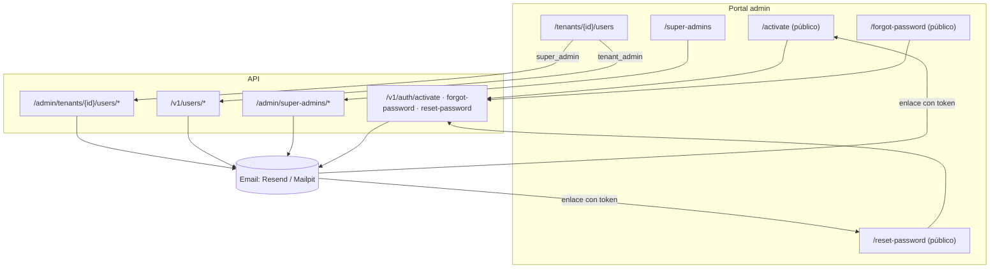

# Módulo 09: Gestión de Usuarios y Recuperación de Acceso

**RF cubiertos:** RF-046 a RF-052
**Prioridad:** P0 (RF-046, RF-051, RF-052) · P1 (RF-047 a RF-050)
**Sprint:** Sprint 9 — ver [sprint_09.md](../../../Planeacion/Sprints/sprint_09.md)
**Responsable de desarrollo:** Cristian Anacona
**Estado:** ✅ Implementado en local — pendiente de revisión y despliegue (T-916)
**Fecha de definición:** 2026-11-05
**Documento padre:** [DEFINICION_SAAS.md](../00_definicion-solucion_saas/DEFINICION_SAAS.md)
**Depende de:** Módulo 08 (Admin Multi-tenant) — amplía y corrige RF-038, RF-039 y RF-040
**Definición técnica:** [DT_gestion_usuarios.md](../../../Definicion-Tecnica/09_gestion_usuarios/DT_gestion_usuarios.md)

---

## Contexto y Alcance

El módulo 08 dejó la base para usuarios: alta por `tenant_admin` vía API, activación por token,
cambio de contraseña y dos endpoints de admin (listar y reenviar activación). Una revisión del
2026-11-05, con código y datos reales de producción, encontró que **en la práctica nadie puede
gestionar usuarios**:

| Hallazgo | Impacto |
|---|---|
| El email de activación enlaza a `<portal>/activate?token=…`, una página que **no existe** (404 en prod y staging) | Ningún usuario creado puede activar su cuenta por el enlace. En producción, 2 de los 3 `tenant_admin` nunca se activaron: **AWP PERFORMANCE (cliente real) y AutolavadoDemo no tienen ningún administrador activo** |
| El portal no tiene ninguna pantalla de usuarios | El super_admin solo puede listarlos y reenviar la activación por API; no crear, editar ni desactivar |
| No existe "olvidé mi contraseña" ni reseteo por un administrador | El 2026-11-05 recuperar el acceso de un super_admin exigió entrar al VPS por SSH |
| No se pueden gestionar super_admins | Solo existe el bootstrap del primero; si ese se pierde, solo queda la base de datos |
| Desactivar un usuario no lo saca: su JWT sigue valiendo hasta 30 min | RF-039 (RN-039-3) promete lo contrario |
| El email es único por tenant, pero el login lo busca en todos los tenants | Si dos tenants comparten un email, el login de ambos falla con error 500 |
| El rol por defecto al crear es `api_consumer`, que ningún permiso reconoce | Un usuario creado con el valor por defecto no puede hacer nada |
| Ninguna acción sobre usuarios queda en `audit_logs` | No hay trazabilidad de quién creó, desactivó o cambió a quién |
| Contraseñas: mínimo 8 para usuarios, 12 para super_admin | Política inconsistente |

**Alcance de este módulo:** corregir lo anterior y dar al portal la gestión completa de usuarios
de un tenant, de super_admins y la recuperación de contraseña por email.

### Lineamientos del requerimiento (obligatorios)

Definidos por Deiby Moreno, responsable del producto, el 2026-11-05. Prevalecen sobre cualquier
otra regla de este módulo.

| ID | Lineamiento |
|---|---|
| **L-1** | **El super_admin actual de cada ambiente es la cuenta raíz y está protegida.** Es la cuenta desde la que se crean todos los demás usuarios, incluidos otros super_admins. Nada en el sistema puede borrarla, desactivarla, cambiarle el rol ni forzar su reseteo: ni otro super_admin, ni un endpoint, ni una migración, ni un test. Solo su propio dueño puede cambiar su contraseña (cambio voluntario u "olvidé mi contraseña"). Ver RN-049-5 y `users.is_protected`. |
| **L-2** | **La gestión de usuarios nace de esa cuenta raíz.** El super_admin raíz crea super_admins y `tenant_admin`; cada `tenant_admin` crea a su equipo. No hay registro abierto ni autoservicio. |
| **L-3** | **No se borra ningún usuario de forma física.** Se desactiva. Aplica a datos reales en cualquier ambiente. |
| **L-4** | **Los tests nunca borran ni modifican datos que no crearon.** El incidente del 2026-10-26 (RN-052-6) borró el super_admin real de staging. |
| **L-5** | **Ningún administrador conoce ni fija la contraseña de otro usuario.** Solo dispara emails de activación o reseteo. |

**Fuera de alcance:** rediseñar el modelo de roles (se mantienen `super_admin`, `tenant_admin`,
`inventory_manager`, `viewer` con los permisos de hoy), borrado físico de usuarios, autenticación
de doble factor y cambio de email de un usuario existente.

### Actores del módulo

| Actor | Qué gestiona | Superficie |
|---|---|---|
| `super_admin` | Usuarios de cualquier tenant y otros super_admins | Portal admin + `/admin/*` |
| `tenant_admin` | Usuarios `inventory_manager` y `viewer` de su propio tenant | Portal admin (vista de su tenant) + `/v1/*` |
| Cualquier usuario | Su propia contraseña: activación, cambio y recuperación | Portal (páginas públicas) + `/v1/auth/*` |

### Diagrama de Contexto

### Estados de un usuario

| Estado | `is_active` | `must_change_password` | Significado |
|---|---|---|---|
| Pendiente de activación | `false` | `true` | Creado; aún no fijó su contraseña con el enlace de activación |
| Activo | `true` | `false` | Puede iniciar sesión |
| Desactivado | `false` | `false` | Un administrador lo desactivó; no puede iniciar sesión |

> El estado se deriva de esos dos campos; no se añade una columna nueva. Activar la cuenta pone
> `is_active=true` y `must_change_password=false`.

---

## Requerimientos Funcionales

### RF-046: Activación de Cuenta desde el Portal

- **ID:** RF-046
- **Módulo:** Gestión de Usuarios
- **Prioridad:** P0 — Bloqueante (hoy ningún usuario nuevo puede activarse)
- **Descripción:** El portal ofrece la página pública `/activate?token=…`, destino del enlace del
  email de activación. El usuario fija ahí su contraseña y queda activo.
- **Pre-condiciones:**
  1. El usuario recibió un email de activación con un token vigente (TTL 48 h).
- **Flujo Principal:**
  1. El usuario abre el enlace; el portal muestra el formulario "Nueva contraseña" + "Repetir contraseña".
  2. El portal valida en cliente que coincidan y cumplan la política (RN-052-4).
  3. El portal llama a `POST /v1/auth/activate` con `{token, password}`.
  4. El sistema fija la contraseña, activa la cuenta y consume el token.
  5. El portal muestra "Cuenta activada" y lleva a `/login` con el email prellenado.
- **Post-condiciones:** usuario activo; token eliminado (un solo uso).
- **Reglas de Negocio:**
  - RN-046-1: La página no requiere sesión y no revela si el token pertenece a un usuario concreto.
  - RN-046-2: Si el usuario activado es `super_admin`, el login posterior entra a `/tenants`; si es
    `tenant_admin`, a su tenant (comportamiento actual de `/login`).
- **Manejo de Errores:**
  - Token inexistente, usado o caducado → mensaje "El enlace no es válido o caducó. Pide a tu
    administrador que te reenvíe la activación." (sin más detalle).
  - Contraseña fuera de política → error de validación en el formulario.

---

### RF-047: Gestión de Usuarios de un Tenant (super_admin)

- **ID:** RF-047
- **Módulo:** Gestión de Usuarios
- **Prioridad:** P1 — Necesario
- **Descripción:** Desde la página `/tenants/{id}/users` del portal, el `super_admin` gestiona todos
  los usuarios de cualquier tenant.
- **Pre-condiciones:**
  1. Sesión de `super_admin` en el portal.
- **Flujo Principal — Listar:**
  1. Desde el detalle del tenant, botón "Gestionar Usuarios".
  2. Tabla con email, nombre, rol, estado (RF-046, tabla de estados), último acceso y fecha de alta.
  3. Filtro por estado (todos / activos / pendientes / desactivados) y búsqueda por email o nombre.
- **Flujo Principal — Crear:**
  1. Botón "+ Nuevo usuario": email, nombre completo y rol (`tenant_admin`, `inventory_manager`, `viewer`).
  2. El sistema crea el usuario pendiente de activación y envía el email de activación.
- **Flujo Principal — Acciones por fila:**
  - **Editar:** nombre y rol.
  - **Desactivar / Reactivar.** Desactivar cierra sus sesiones (RF-051).
  - **Reenviar activación** (solo si está pendiente).
  - **Forzar reseteo de contraseña** (solo si está activo): envía el email de reseteo (RF-050) y cierra sus sesiones.
- **Post-condiciones:** cada acción queda en `audit_logs` del tenant (RN-052-5).
- **Reglas de Negocio:**
  - RN-047-1: El `super_admin` puede asignar `tenant_admin`, `inventory_manager` o `viewer`; nunca `super_admin` (ver RF-049).
  - RN-047-2: El super_admin nunca ve ni fija la contraseña de otro usuario: solo dispara emails.
  - RN-047-3: Desactivar al último `tenant_admin` activo de un tenant activo exige confirmación
    explícita en el portal ("El tenant se quedará sin administrador"). No se bloquea: es una decisión del super_admin.
  - RN-047-4: El email no se edita. Para cambiarlo se crea un usuario nuevo y se desactiva el anterior.
  - RN-047-5: No hay borrado físico: se desactiva. Así se conserva el rastro de auditoría y las referencias `created_by`.
- **Manejo de Errores:**
  - Email ya registrado en cualquier tenant → `409` "El email ya está registrado" (RN-052-1).
  - Usuario que no pertenece al tenant → `404`.
  - Reenviar activación a un usuario ya activo → `409`.
  - Forzar reseteo a un usuario pendiente o desactivado → `409` (para pendientes, reenviar activación).

---

### RF-048: Gestión del Equipo por el Tenant Admin

- **ID:** RF-048
- **Módulo:** Gestión de Usuarios
- **Prioridad:** P1 — Necesario
- **Descripción:** El `tenant_admin` gestiona los usuarios de su propio tenant por API (`/v1/users`) y
  desde la misma página del portal, que en su caso muestra solo su tenant y opera contra `/v1/*`.
  Sustituye a RF-039, cuyas reglas se corrigen aquí.
- **Pre-condiciones:**
  1. Sesión de `tenant_admin` activo, en un tenant activo.
- **Flujo Principal:** igual que RF-047 (listar, crear, editar, desactivar/reactivar, reenviar
  activación, forzar reseteo) con estas restricciones:
- **Reglas de Negocio:**
  - RN-048-1: Solo crea o asigna `inventory_manager` y `viewer`. No crea `tenant_admin` (eso lo hace
    el super_admin, RF-047). Se mantiene la regla D-04 de no escalar privilegios.
  - RN-048-2: No puede editar, desactivar ni resetear a otro `tenant_admin`.
  - RN-048-3: No puede desactivarse a sí mismo (RN-039-4, hoy no se cumple).
  - RN-048-4: El rol por defecto al crear es `viewer` (hoy es `api_consumer`, que no tiene permisos).
  - RN-048-5: RLS garantiza que solo ve y toca usuarios de su tenant; un `user_id` ajeno da `404`.
- **Manejo de Errores:**
  - Rol no permitido → `403`.
  - Acción sobre un `tenant_admin` o sobre sí mismo (desactivar) → `403`.
  - Email duplicado → `409`.

---

### RF-049: Gestión de Super Admins

- **ID:** RF-049
- **Módulo:** Gestión de Usuarios
- **Prioridad:** P1 — Necesario
- **Descripción:** Página `/super-admins` del portal (solo `super_admin`) para listar, crear,
  desactivar/reactivar y forzar el reseteo de contraseña de otros super_admins. El bootstrap
  (`POST /admin/auth/register`) queda solo para el primero de cada ambiente.
- **Pre-condiciones:**
  1. Sesión de `super_admin`.
- **Flujo Principal — Crear:**
  1. Email y nombre completo.
  2. El sistema crea el usuario con `role=super_admin` en el tenant interno `micronuba-internal`,
     pendiente de activación, y envía el email de activación.
- **Reglas de Negocio:**
  - RN-049-1: Un super_admin no puede desactivarse a sí mismo.
  - RN-049-2: Siempre debe quedar al menos un super_admin activo. Desactivar al último → `409`.
  - RN-049-3: Mismas reglas de email único, auditoría y política de contraseña (RF-052). La auditoría
    se registra en el tenant interno.
  - RN-049-4: Los super_admins no aparecen en la gestión de usuarios de tenants (RF-047), ni siquiera
    en la del tenant interno.
  - RN-049-5: **Cuenta raíz protegida (L-1).** El super_admin existente en cada ambiente al aplicar
    la migración 016 queda marcado como protegido (`is_protected=true`). Sobre una cuenta protegida
    nadie puede: desactivarla, cambiarle el nombre o el rol, ni forzar su reseteo. En la tabla de
    `/super-admins` aparece con la etiqueta "Raíz" y sin acciones. Su dueño sí puede cambiar su propia
    contraseña (RF-040) y usar "olvidé mi contraseña" (RF-050).
  - RN-049-6: Los super_admins creados desde el portal **no** son protegidos. Proteger otra cuenta no
    se hace desde la aplicación: es una decisión del responsable del producto y se aplica en base de
    datos.
- **Manejo de Errores:**
  - Desactivarse a sí mismo → `403`.
  - Cualquier modificación o reseteo forzado sobre una cuenta protegida → `403` "Cuenta raíz protegida".
  - Dejar el sistema sin super_admin activo → `409`.
  - Email duplicado → `409`.

---

### RF-050: Recuperación de Contraseña ("Olvidé mi contraseña")

- **ID:** RF-050
- **Módulo:** Gestión de Usuarios
- **Prioridad:** P1 — Necesario
- **Descripción:** Cualquier usuario activo recupera el acceso con un enlace de un solo uso
  enviado a su email. Es también el mecanismo del "forzar reseteo" de RF-047, RF-048 y RF-049.
- **Flujo Principal:**
  1. En `/login`, enlace "¿Olvidaste tu contraseña?" que lleva a `/forgot-password`.
  2. El usuario escribe su email; el portal llama a `POST /v1/auth/forgot-password`.
  3. El portal muestra siempre el mismo mensaje: "Si el email está registrado, recibirás un enlace
     en unos minutos."
  4. Si el email pertenece a un usuario activo, el sistema genera un token (TTL 60 min, un solo uso)
     y envía el email `password_reset` con el enlace `<portal>/reset-password?token=…`.
  5. En `/reset-password`, el usuario fija la contraseña nueva; el portal llama a
     `POST /v1/auth/reset-password`.
  6. El sistema cambia la contraseña, consume el token, cierra todas sus sesiones (RF-051), borra sus
     contadores de intentos fallidos de login y envía el email `password_changed`.
- **Reglas de Negocio:**
  - RN-050-1: La respuesta a `forgot-password` es idéntica exista o no el email, esté activo o no.
    No debe permitir averiguar qué emails tienen cuenta.
  - RN-050-2: Usuario pendiente de activación: no se envía reseteo, se reenvía la activación
    (misma respuesta pública).
  - RN-050-3: Usuario desactivado o de un tenant suspendido: no se envía nada (misma respuesta pública).
  - RN-050-4: Pedir un enlace nuevo invalida el anterior: solo vale el último token de cada usuario.
  - RN-050-5: Límite de solicitudes: 3 por email y hora, y 10 por IP y hora. Al superarlo, `429`.
  - RN-050-6: Aplica a todos los roles, incluido `super_admin`.
- **Manejo de Errores:**
  - Token inválido, usado o caducado → `400` "El enlace no es válido o caducó."
  - Contraseña fuera de política → `422`.

---

### RF-051: Revocación Inmediata de Sesiones

- **ID:** RF-051
- **Módulo:** Gestión de Usuarios
- **Prioridad:** P0 — Seguridad
- **Descripción:** Desactivar un usuario, forzar su reseteo o completar un reseteo de contraseña
  cierra **todas** sus sesiones al momento: el access token deja de valer en el siguiente request
  y sus refresh tokens se invalidan.
- **Reglas de Negocio:**
  - RN-051-1: Sustituye a RN-039-3 ("sin invalidar tokens activos"), que dejaba hasta 30 minutos de
    acceso a un usuario desactivado.
  - RN-051-2: El cambio voluntario de contraseña (RF-040) **no** cierra las demás sesiones: se
    mantiene RN-040-2.
  - RN-051-3: Las API Keys no son sesiones de usuario y no se ven afectadas.
- **Manejo de Errores:**
  - Request con un token revocado → `401` "Sesión cerrada. Vuelve a iniciar sesión."

---

### RF-052: Correcciones de Consistencia y Seguridad

- **ID:** RF-052
- **Módulo:** Gestión de Usuarios
- **Prioridad:** P0 — Corrige comportamiento actual
- **Reglas de Negocio:**
  - RN-052-1: **El email es único en toda la plataforma** y sin distinguir mayúsculas. Sustituye a
    RN-039-2 ("único dentro del tenant"), incompatible con un login que busca el email en todos los
    tenants. Verificado el 2026-11-05: en producción no hay duplicados.
  - RN-052-2: Los emails se guardan y se comparan en minúsculas, también en el login.
  - RN-052-3: `api_consumer` deja de ser un rol asignable (ningún permiso lo reconoce). En producción
    no existe ningún usuario con ese rol.
  - RN-052-4: **Política de contraseña única: mínimo 12 caracteres** en activación, cambio y reseteo
    (hoy 8 para usuarios y 12 para super_admin). Las contraseñas actuales siguen valiendo hasta que se cambien.
  - RN-052-5: Toda acción sobre usuarios queda en `audit_logs`: alta, edición (con valores anterior y
    nuevo), desactivación, reactivación, reenvío de activación, reseteo forzado, reseteo completado y
    activación. Quién la hizo y desde qué IP.
  - RN-052-6: Los tests no pueden borrar datos que no crearon (L-4). Hoy `test_admin_auth.py` borra **todos**
    los super_admins antes de cada test; el 2026-10-26 eso eliminó el super_admin real de staging al
    correr la suite allí.

---

## Historias de Usuario

### HU-USR-001: Activar mi cuenta

- **Narrativa:** Como **usuario nuevo**, quiero fijar mi contraseña desde el enlace del email, para empezar a usar la plataforma.
- **Criterios de Aceptación:**
  1. **Dado** un enlace de activación vigente, **Cuando** lo abro, **Entonces** veo el formulario de contraseña (no un 404).
  2. **Dado** que fijo una contraseña de 12+ caracteres, **Cuando** confirmo, **Entonces** mi cuenta queda activa y puedo iniciar sesión.
  3. **Dado** que reutilizo el enlace ya usado, **Cuando** lo abro, **Entonces** veo "El enlace no es válido o caducó".

### HU-USR-002: Dar de alta al equipo de un cliente

- **Narrativa:** Como **super_admin**, quiero crear y administrar los usuarios de un tenant desde el portal, para incorporar a sus administradores sin usar la API.
- **Criterios de Aceptación:**
  1. **Dado** un tenant, **Cuando** creo un `tenant_admin`, **Entonces** aparece como "Pendiente" y recibe el email de activación.
  2. **Dado** un usuario pendiente, **Cuando** pulso "Reenviar activación", **Entonces** recibe un enlace nuevo.
  3. **Dado** un usuario activo con sesión abierta, **Cuando** lo desactivo, **Entonces** su siguiente request recibe `401`.
  4. **Dado** que creo un usuario con un email que ya existe en otro tenant, **Entonces** recibo "El email ya está registrado".

### HU-USR-003: Gestionar mi equipo como tenant_admin

- **Narrativa:** Como **tenant_admin**, quiero gestionar los usuarios de mi empresa, para dar y quitar accesos sin depender de MicroNuba.
- **Criterios de Aceptación:**
  1. **Dado** que soy `tenant_admin`, **Cuando** creo un usuario sin indicar rol, **Entonces** se crea como `viewer`.
  2. **Dado** que intento crear un `tenant_admin`, **Entonces** recibo `403`.
  3. **Dado** que intento desactivarme a mí mismo, **Entonces** recibo `403`.
  4. **Dado** que entro al portal, **Entonces** solo veo los usuarios de mi tenant.

### HU-USR-004: Recuperar mi contraseña

- **Narrativa:** Como **usuario que olvidó su contraseña**, quiero recibir un enlace para fijar una nueva, sin depender de un administrador.
- **Criterios de Aceptación:**
  1. **Dado** un email registrado o no, **Cuando** pido el enlace, **Entonces** veo el mismo mensaje.
  2. **Dado** que pedí dos enlaces, **Cuando** uso el primero, **Entonces** no funciona; el segundo sí.
  3. **Dado** que completo el reseteo, **Entonces** mis sesiones abiertas en otros dispositivos se cierran y recibo el email de confirmación.
  4. **Dado** que estaba bloqueado por intentos fallidos de login, **Cuando** completo el reseteo, **Entonces** puedo iniciar sesión de inmediato.

### HU-USR-005: Administrar super_admins

- **Narrativa:** Como **super_admin**, quiero dar de alta a otro super_admin y resetear su acceso desde el portal, para no depender de la base de datos ni de una sola persona.
- **Criterios de Aceptación:**
  1. **Dado** que creo un super_admin, **Entonces** recibe la activación y, al activarse, entra al portal con acceso completo.
  2. **Dado** que soy el único super_admin activo, **Cuando** intento desactivarme o desactivar al último, **Entonces** el sistema lo impide.
  3. **Dado** que soy un super_admin creado desde el portal, **Cuando** intento desactivar, editar o forzar el reseteo de la cuenta raíz, **Entonces** recibo `403` y la cuenta raíz no cambia.
  4. **Dado** que soy el dueño de la cuenta raíz, **Cuando** uso "olvidé mi contraseña", **Entonces** puedo recuperar mi acceso.

### HU-USR-006: Saber quién cambió qué

- **Narrativa:** Como **responsable de la plataforma**, quiero que cada acción sobre usuarios quede registrada, para auditar accesos.
- **Criterios de Aceptación:**
  1. **Dado** que cambio el rol de un usuario, **Entonces** `audit_logs` registra el rol anterior, el nuevo, quién lo hizo y la IP.

---

## Modelo de Datos del Módulo

### Cambios a tablas existentes

| Tabla | Cambio | Motivo |
|---|---|---|
| `users` | Índice único sobre `lower(email)` (migración 016) | RN-052-1. El índice actual `(tenant_id, email)` se mantiene |
| `users` | Normalizar `email` a minúsculas (migración 016) | RN-052-2 |
| `users` | Columna `is_protected boolean NOT NULL DEFAULT false`; la migración 016 la pone a `true` en el super_admin activo existente | L-1, RN-049-5 |

El estado (pendiente / activo / desactivado) no es una columna: se deriva de `is_active` y `must_change_password`.

### Redis — claves nuevas

| Clave | Valor | TTL | Uso |
|---|---|---|---|
| `pwd_reset:<token>` | `user_id` | 60 min | Token de reseteo (RF-050) |
| `pwd_reset_user:<user_id>` | último token emitido | 60 min | Invalidar el anterior (RN-050-4) |
| `user_sessions:<user_id>` | set de refresh tokens | 7 días | Cerrar todas las sesiones (RF-051) |
| `user_revoked_at:<user_id>` | timestamp | 30 min | Rechazar access tokens anteriores a la revocación (RF-051) |
| `pwd_forgot:email:<email>` / `pwd_forgot:ip:<ip>` | contador | 60 min | Límite de solicitudes (RN-050-5) |

---

## Matriz de Endpoints del Módulo

### Superficie Admin (`/admin/*`) — solo super_admin

| Método | Endpoint | RF | Estado |
|---|---|---|---|
| `GET` | `/admin/tenants/{id}/users` | RF-047 | Existe — añadir filtros `status` y `q` |
| `POST` | `/admin/tenants/{id}/users` | RF-047 | **Nuevo** |
| `PATCH` | `/admin/tenants/{id}/users/{uid}` | RF-047 | **Nuevo** |
| `POST` | `/admin/tenants/{id}/users/{uid}/resend-activation` | RF-047 | Existe |
| `POST` | `/admin/tenants/{id}/users/{uid}/password-reset` | RF-047 | **Nuevo** |
| `GET` | `/admin/super-admins` | RF-049 | **Nuevo** |
| `POST` | `/admin/super-admins` | RF-049 | **Nuevo** |
| `PATCH` | `/admin/super-admins/{uid}` | RF-049 | **Nuevo** |
| `POST` | `/admin/super-admins/{uid}/password-reset` | RF-049 | **Nuevo** |

### Superficie Cliente (`/v1/*`)

| Método | Endpoint | Rol | RF | Estado |
|---|---|---|---|---|
| `GET` | `/v1/users` | tenant_admin | RF-048 | Existe — añadir filtros |
| `POST` | `/v1/users` | tenant_admin | RF-048 | Existe — corregir roles y defecto |
| `PATCH` | `/v1/users/{uid}` | tenant_admin | RF-048 | Existe — añadir `role` y restricciones |
| `POST` | `/v1/users/{uid}/password-reset` | tenant_admin | RF-048 | **Nuevo** |
| `POST` | `/v1/auth/activate` | público | RF-046 | Existe — política 12 caracteres |
| `POST` | `/v1/auth/forgot-password` | público | RF-050 | **Nuevo** |
| `POST` | `/v1/auth/reset-password` | público | RF-050 | **Nuevo** |

### Portal

| Página | Acceso | RF |
|---|---|---|
| `/activate` | Público | RF-046 |
| `/forgot-password` | Público | RF-050 |
| `/reset-password` | Público | RF-050 |
| `/tenants/{id}/users` | super_admin (cualquier tenant) · tenant_admin (solo el suyo) | RF-047, RF-048 |
| `/super-admins` | super_admin | RF-049 |
