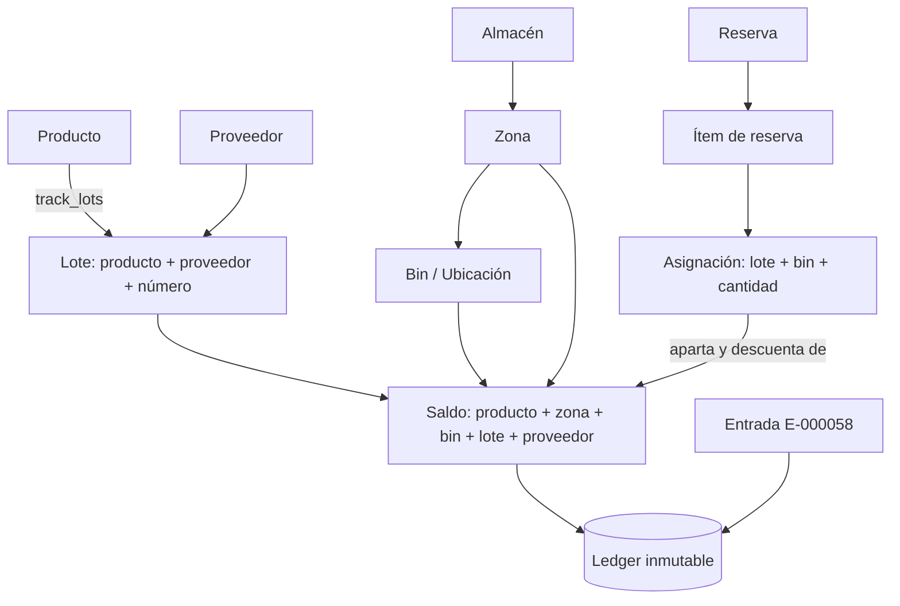

# Módulo 10: Trazabilidad de Lotes, Proveedores y Ubicaciones

**RF cubiertos:** RF-053 a RF-061
**Prioridad:** P0 (RF-053, RF-054, RF-055, RF-061) · P1 (RF-056 a RF-059) · P2 (RF-060)
**Sprint:** Sprint 10 — ver [sprint_10.md](../../../Planeacion/Sprints/sprint_10.md)
**Solicitante:** Appits (Gestión de Talleres), consumidor del API
**Responsable de desarrollo:** Cristian Anacona
**Estado:** ✅ Implementado y probado en local — pendiente de commit, merge y despliegue
**Fecha de definición:** 2026-11-04
**Documento padre:** [DEFINICION_SAAS.md](../00_definicion-solucion_saas/DEFINICION_SAAS.md)
**Depende de:** Módulo 03 (Almacenes, zonas y bins), Módulo 04 (Motor transaccional) y Módulo 05 (Reservas) — amplía y corrige RF-016, RF-025, RF-026 y RF-027
**Definición técnica:** [DT_trazabilidad_lotes_ubicaciones.md](../../../Definicion-Tecnica/10_trazabilidad_lotes_ubicaciones/DT_trazabilidad_lotes_ubicaciones.md)
**Contrato para Appits (con ejemplos reales):** [trazabilidad_lotes_ubicaciones.md](../../../integracion/trazabilidad_lotes_ubicaciones.md)

---

## Contexto y Alcance

Appits necesita saber **dónde está cada repuesto** (bodega → zona → ubicación), **de qué proveedor
vino cada lote** y **en qué orden de servicio se usó**. Antes de este módulo el inventario lo
resolvía solo a medias:

| Necesidad de Appits | Situación antes | Impacto |
|---|---|---|
| Saber en qué estante está un repuesto | El saldo se llevaba por producto + zona. Los bins existían (módulo 03) pero ningún movimiento ni saldo los usaba | Dos estantes de la misma zona eran una sola cifra |
| Saber de qué proveedor vino un lote | El lote no tenía proveedor y su número era único por producto | El mismo número `L-100` de dos proveedores chocaba (`409`) o se fusionaba |
| Saber con qué orden de servicio se gastó un lote | Una reserva no indicaba lote; al confirmar no había desglose | Imposible reconstruir "este lote se usó en la OT-892" |
| Reservar sin escoger lote a mano | El inventario no elegía lote | Appits tenía que decidir qué lote consumir |

La revisión del código para implementarlo destapó además tres fallos silenciosos (RF-061): una
confirmación que descontaba la cantidad de **todos** los saldos de la zona, un `GET /v1/ledger` que
respondía `500` si existía una reserva confirmada, y la posibilidad de confirmar más de lo reservado.

**Alcance de este módulo:** ubicación exacta, proveedor del lote, reservas con lote (FEFO/FIFO y
desglose), filtros de consulta, lote obligatorio cuando el producto lo maneja, consecutivo de
entradas, la vista del portal que lo muestra y las correcciones anteriores.

### Condiciones del requerimiento (obligatorias)

Definidas por el solicitante el 2026-11-04. Prevalecen sobre cualquier otra regla de este módulo.

| ID | Condición |
|---|---|
| **C-1** | **Todo campo nuevo es opcional.** Una llamada actual de Appits, sin campos nuevos, se comporta igual |
| **C-2** | **Ningún campo existente cambia de nombre ni de tipo.** Las respuestas conservan todos sus campos; solo se agregan |
| **C-3** | **No hay pantallas nuevas en el portal admin.** Lo que ya existe se reorganiza |
| **C-4** | **El ledger sigue siendo inmutable:** solo se agregan registros |
| **C-5** | Los ajustes conservan `lot_number` y `reason` por ítem tal como están |
| **C-6** | No se toca el repositorio `SAAS-Gestion_Talleres` |
| **C-7** | No hay commit ni push hasta que el responsable lo apruebe |
| **C-8** | **Identidad del lote = producto + proveedor + número de lote.** Propuesta aprobada el 2026-11-04 |

**Fuera de alcance:** el vencimiento como campo capturable en el portal, los conteos cíclicos por lote
y bin (ver *Deuda conocida* en la DT), y cualquier cambio en los permisos de los roles.

### Actores del módulo

| Actor | Qué hace | Superficie |
|---|---|---|
| Appits (API Key del tenant) | Entradas, salidas, traslados, ajustes y reservas con lote, bin y proveedor; consulta saldos y ledger | `/v1/*` |
| `super_admin` | Ve las existencias por ubicación y lote y las ajusta desde el portal | Portal admin + `/admin/*` |
| `tenant_admin` | Igual que el super_admin, sobre su propio tenant | Portal admin |

### Modelo conceptual

### Identidad del lote y clave del saldo

| Concepto | Identificado por | Nota |
|---|---|---|
| **Lote** | producto + proveedor + número de lote | `L-100` de dos proveedores son dos lotes con saldos separados |
| **Saldo** | producto + zona + bin + lote + proveedor | El proveedor solo entra en la clave **si hay lote** (RN-054-2) |
| **Stock sin ubicar** | Saldo con `bin_id = null` | Lo que ya existía queda así; lo que entra sin bin también |

---

## Requerimientos Funcionales

### RF-053: Ubicación Exacta (Bin) en Movimientos y Saldos

- **ID:** RF-053
- **Módulo:** Trazabilidad
- **Prioridad:** P0
- **Descripción:** Entradas, salidas, traslados y ajustes aceptan un `bin_id` opcional por ítem. El
  saldo se lleva por bin y cada movimiento del ledger guarda la ubicación en que ocurrió.
- **Pre-condiciones:**
  1. El bin existe, pertenece al tenant y está activo (módulo 03).
- **Flujo Principal:**
  1. Appits envía el movimiento con `items[].bin_id` (en traslados, `from_bin_id` y `to_bin_id`).
  2. El sistema valida que el bin pertenezca a la zona indicada y al tenant.
  3. Localiza o crea el saldo de producto + zona + bin + lote + proveedor y aplica el movimiento.
  4. Escribe el ledger con el `bin_id`.
- **Post-condiciones:** el saldo de ese bin cambia; el de las demás ubicaciones de la zona no.
- **Reglas de Negocio:**
  - RN-053-1: En un traslado, `from_bin_id` debe ser de `source_zone_id` y `to_bin_id` de `target_zone_id`.
  - RN-053-2: Una salida o ajuste **sin** `bin_id` opera sobre el stock sin ubicar, no sobre los bins.
  - RN-053-3: Una reserva sin `bin_id` busca stock en **toda la zona** (RF-055).
  - RN-053-4: El stock existente antes de este módulo queda con `bin_id = null`: no se mueve ni se renombra.
- **Manejo de Errores:**
  - Bin inexistente o de otro tenant → `404` (igual que si no existiera).
  - Bin de otra zona o inactivo → `422`.

---

### RF-054: Proveedor del Lote

- **ID:** RF-054
- **Módulo:** Trazabilidad
- **Prioridad:** P0
- **Descripción:** La entrada indica de qué proveedor viene la mercancía. El lote guarda ese
  proveedor y el mismo número de lote de dos proveedores se mantiene como dos lotes distintos.
- **Flujo Principal:**
  1. La entrada trae `supplier_id` en la cabecera; un ítem puede sobrescribirlo con `items[].supplier_id`.
  2. Si el producto tiene `track_lots = true` y el ítem trae `lot_number`, el sistema **crea el lote**
     (o reutiliza el existente) heredando `supplier_id` y `expiry_date`.
  3. El saldo y el ledger guardan el proveedor.
- **Reglas de Negocio:**
  - RN-054-1: El mismo `lot_number` de dos proveedores son dos lotes, con saldos y vencimientos separados.
  - RN-054-2: El proveedor entra en la clave del saldo **solo si hay lote**. Así una salida sin lote
    nunca se vuelve ambigua por culpa del proveedor.
  - RN-054-3: Una salida, ajuste o traslado sin `supplier_id` sobre un lote que existe de **dos
    proveedores** en esa ubicación → `409` pidiendo el proveedor.
  - RN-054-4: En un traslado el lote **viaja con su proveedor**; solo cambian zona y/o bin.
  - RN-054-5: `POST /v1/batches` acepta `supplier_id`; el número es único por producto + proveedor.
- **Manejo de Errores:**
  - Proveedor de otro tenant o inexistente → `404`.
  - Mismo proveedor repite el número de lote del producto → `409`.
  - Lote ambiguo entre proveedores sin `supplier_id` → `409`.

---

### RF-055: Reservas con Lote — FEFO/FIFO y Desglose

- **ID:** RF-055
- **Módulo:** Trazabilidad
- **Prioridad:** P0
- **Descripción:** Una reserva puede pedir lote, bin y proveedor, o dejar que el inventario elija. La
  respuesta trae el **desglose real** de lo que se apartó (`allocations`) y la confirmación despacha
  lote por lote dejando en el ledger qué orden de servicio consumió cada uno.
- **Flujo Principal — Crear (`POST /v1/reservations`):**
  1. Por ítem llegan `lot_number`, `bin_id` y `supplier_id`, todos opcionales.
  2. El sistema busca saldos con disponible en la zona, filtrando por lo que se pidió, y los
     **bloquea** (`FOR UPDATE`) para que dos reservas simultáneas no aparten lo mismo.
  3. Si no se pidió lote y el producto maneja lotes: primero el que **vence antes** (FEFO); sin
     vencimientos, el que **entró primero** (FIFO).
  4. Si un lote no alcanza, el ítem **se reparte** en varios (una asignación por lote/bin).
  5. Responde con `allocations[]` en orden de consumo.
- **Flujo Principal — Confirmar (`POST /v1/reservations/{id}/confirm`):**
  1. Despacha en el orden de `allocations`, creando una `Transaction` de salida.
  2. Deja **un `ISSUE` por lote/bin** en el ledger, con `reference_id` = el de la reserva (la orden de Appits).
  3. Si se confirma menos de lo reservado, libera lo que sobra.
- **Reglas de Negocio:**
  - RN-055-1: Criterio FEFO → FIFO (la fecha de primera entrada del lote desempata). El stock sin lote queda al final.
  - RN-055-2: Confirmar **más** de lo reservado → `422`.
  - RN-055-3: **Cancelar** y la **expiración automática** liberan exactamente lo que apartó cada asignación.
  - RN-055-4: Las reservas **no se rechazan** por no traer lote, aunque el producto maneje lotes (RF-057).
  - RN-055-5: Las reservas anteriores a este módulo no tienen asignaciones: se confirman, cancelan y
    expiran contra el saldo de producto + zona, como antes.
- **Manejo de Errores:**
  - Stock disponible insuficiente → `409`.
  - Lote, bin o proveedor de otro tenant → `409` (sin stock) o `404` según el campo (ver DT §4.2).

---

### RF-056: Consulta por Lote, Ubicación y Proveedor

- **ID:** RF-056
- **Módulo:** Trazabilidad
- **Prioridad:** P1
- **Descripción:** Los saldos y el ledger se pueden filtrar por lote, ubicación y proveedor, y cada fila
  responde con su ubicación, proveedor y vencimiento. Responde "¿dónde está el lote X y de qué
  proveedor vino?" y "¿en qué órdenes se usó?".
- **Flujo Principal:**
  1. `GET /v1/stock/balances` acepta `lot_number`, `bin_id` y `supplier_id`.
  2. `GET /v1/ledger` acepta `lot_number`, `zone_id`, `bin_id`, `supplier_id`, `reference_id`,
     `document_number`, `date_from` y `date_to`.
  3. Cada saldo responde además con `bin_id`, `bin_code`, `bin_name`, `supplier_id` y `expiry_date`
     (el vencimiento del lote). Cada movimiento, con esos mismos más `document_number`.
- **Reglas de Negocio:**
  - RN-056-1: `date_from` y `date_to` son `YYYY-MM-DD`, **ambos inclusivos**, en UTC.
  - RN-056-2: Un lote de otro tenant no aparece en saldos ni en el ledger (RLS).
  - RN-056-3: El super_admin dispone de `GET /admin/tenants/{id}/suppliers` para nombrar proveedores
    en el portal; incluye inactivos, porque un saldo histórico puede apuntar a uno desactivado.
- **Manejo de Errores:** Fecha mal formada → `422`.

---

### RF-057: Lote Obligatorio cuando el Producto lo Maneja

- **ID:** RF-057
- **Módulo:** Trazabilidad
- **Prioridad:** P1
- **Descripción:** Entradas, ajustes y traslados de un producto con `track_lots = true` exigen
  `lot_number` en cada ítem. Hace efectivo lo que RF-010 y RF-016 ya prometían.
- **Reglas de Negocio:**
  - RN-057-1: Sin `lot_number` → `422` con el mensaje "El producto {sku} maneja lotes (track_lots =
    true): el ítem debe incluir lot_number."
  - RN-057-2: Las **reservas** no se rechazan: el inventario elige el lote (RN-055-4).
  - RN-057-3: Las **salidas** no exigen lote: pueden salir del stock sin lote (histórico).
- **Manejo de Errores:** `422` como arriba.

---

### RF-058: Consecutivo de Entradas

- **ID:** RF-058
- **Módulo:** Trazabilidad
- **Prioridad:** P1
- **Descripción:** Cada entrada de mercancía recibe un número legible y consecutivo por tenant
  (`E-000058`), que se devuelve en la respuesta y sirve para buscarla en el ledger.
- **Flujo Principal:**
  1. Al registrar la entrada, el sistema toma el siguiente valor de la secuencia del tenant.
  2. Lo guarda en la transacción y en cada línea del ledger, y lo devuelve como `document_number`.
  3. `GET /v1/ledger?document_number=E-000058` encuentra sus movimientos.
- **Reglas de Negocio:**
  - RN-058-1: La secuencia es **por tenant** y solo numera entradas (`RECEIPT`).
  - RN-058-2: No hay huecos ni duplicados: el número se toma dentro de la misma transacción de la
    entrada. Si la entrada falla, el número no se consume; dos entradas simultáneas se serializan.
  - RN-058-3: Las entradas históricas se numeran al migrar, en orden cronológico por tenant, y la
    secuencia continúa donde terminan.
  - RN-058-4: `document_number` es único por tenant.

---

### RF-059: Portal — Productos con Existencias por Ubicación y Lote

- **ID:** RF-059
- **Módulo:** Portal admin
- **Prioridad:** P1
- **Descripción:** La pantalla **Productos** del tenant muestra también las existencias: cuánto hay
  disponible de cada producto y, al abrirlo, en qué almacén, zona, ubicación, lote y proveedor. La
  pantalla **Stock** sale del menú. Cumple C-3: no se crea ninguna pantalla nueva.
- **Flujo Principal:**
  1. Tabla de productos con *Producto, Unidad, Precio, Disponible, Dónde está* y acciones.
  2. Cada fila se expande en un desglose con *Almacén, Zona, Ubicación, Lote, Proveedor, Físico,
     Reservado, Disponible* y un botón para ajustar **esa** fila.
  3. Botones **Entrada de stock** (con campo *Lote*), **Ajustar stock** y **Nuevo producto**.
- **Reglas de Negocio:**
  - RN-059-1: El desglose no omite datos: almacén con su código; zona con su tipo, nombre y código;
    ubicación con código y nombre; proveedor con nombre y código.
  - RN-059-2: El ajuste de una fila actúa sobre ese saldo exacto (zona + ubicación + lote + proveedor),
    nunca sobre el total del producto.
  - RN-059-3: Se muestra "Sin ubicar" cuando no hay bin y "Proveedor no encontrado" si el saldo apunta
    a un proveedor que ya no se puede resolver.
  - RN-059-4: La página `/tenants/{id}/stock` se conserva intacta, con sus columnas *Lote* y *Ubicación*,
    pero fuera del menú (`SHOW_STOCK_PAGE = False`). Volver a mostrarla es cambiar una constante.
  - RN-059-5: **Limitación conocida:** los formularios del portal piden *Lote* pero no *ubicación* ni
    *proveedor*; esos se asignan por API. El vencimiento tampoco se muestra ni se captura aún.
  - RN-059-6: Si el producto maneja lotes, el portal exige el lote en la entrada (RF-057).

---

### RF-060: Portal — Rediseño Visual

- **ID:** RF-060
- **Módulo:** Portal admin
- **Prioridad:** P2
- **Descripción:** El portal adopta un sistema visual único: barra lateral de navegación, tarjetas,
  píldoras de estado, tipografía y colores coherentes en todas sus páginas. Se eligió la opción A de
  dos propuestas presentadas.
- **Alcance:** `/login`, `/tenants`, `/tenants/{id}`, `/tenants/{id}/products`, `/tenants/{id}/stock`
  y `/tenants/{id}/warehouses`.
- **Reglas de Negocio:**
  - RN-060-1: Los colores de estado están oscurecidos para que el texto sobre ellos supere el contraste 4.5:1.
  - RN-060-2: Las categorías se muestran con una baldosa de color rotativo y un ícono elegido por
    palabra clave del nombre; lo que no encaje usa un ícono genérico. No se guarda nada en base de datos.
  - RN-060-3: El nombre completo del tenant en la barra lateral pasa a la línea siguiente, nunca se corta.
  - RN-060-4: Cumple C-3: reorganiza pantallas existentes, no crea flujos nuevos.

---

### RF-061: Correcciones de Consistencia

- **ID:** RF-061
- **Módulo:** Trazabilidad
- **Prioridad:** P0 — Corrige comportamiento actual
- **Reglas de Negocio:**
  - RN-061-1: **Confirmar una reserva descontaba la cantidad de todos los saldos de la zona.** La
    confirmación hacía `UPDATE stock_balances … WHERE product_id AND zone_id`; con varios lotes en la
    zona, cada fila perdía la cantidad completa. Ahora actúa sobre las filas que la reserva apartó.
    Mismo defecto en el bucle de expiración de `app/main.py`, que ahora llama a `expire_reservation`.
  - RN-061-2: **`GET /v1/ledger` respondía `500`** si existía una reserva confirmada, porque escribía
    el ledger sin `transaction_id` y la respuesta lo exigía. Ahora la confirmación crea su `Transaction`
    y `transaction_id` es opcional en la respuesta (solo las filas antiguas lo traen `null`).
  - RN-061-3: **Confirmar más de lo reservado** se aceptaba y descontaba de más; ahora `422` (RN-055-2).
  - RN-061-4: Aislamiento entre tenants: un bin o proveedor de otro tenant responde `404`, y un lote de
    otro tenant no aparece en saldos ni en el ledger (RLS más validación en el servicio).

#### Cambios de comportamiento que Appits debe conocer

Son los únicos casos en que una llamada actual puede responder distinto (C-1 se cumple en todo lo demás):

| # | Cambio | Quién lo nota |
|---|---|---|
| 1 | `track_lots = true` **exige lote** en entradas, ajustes y traslados (`422`) | Si Appits hoy hace entradas sin lote de esos productos, empezarán a fallar |
| 2 | Confirmar más de lo reservado responde `422` | Quien confirmaba de más |
| 3 | El `reference_id` del `ISSUE` de una confirmación es el de la **reserva**, no el `issue_reference` | Nadie, si Appits manda el mismo valor en ambos |

---

## Historias de Usuario

### HU-LOT-001: Saber dónde está un repuesto

- **Narrativa:** Como **jefe de taller (Appits)**, quiero saber en qué bodega, zona y estante está cada repuesto, para encontrarlo sin buscar.
- **Criterios de Aceptación:**
  1. **Dado** una entrada con `bin_id`, **Cuando** consulto los saldos, **Entonces** veo ese saldo en su bin y los demás estantes de la zona no cambian.
  2. **Dado** un bin de otra zona, **Cuando** lo uso en un movimiento, **Entonces** recibo `422`.
  3. **Dado** que consulto `?bin_id=…`, **Entonces** veo solo lo que hay en ese estante.

### HU-LOT-002: Saber de qué proveedor vino un lote

- **Narrativa:** Como **responsable de calidad**, quiero saber qué proveedor trajo cada lote, para reclamar si el repuesto sale defectuoso.
- **Criterios de Aceptación:**
  1. **Dado** dos entradas con el mismo número de lote y distinto proveedor, **Entonces** existen dos lotes con saldos separados.
  2. **Dado** una entrada con `supplier_id` y producto con `track_lots`, **Entonces** el lote queda creado con ese proveedor y su vencimiento.
  3. **Dado** una salida de un lote repetido sin `supplier_id`, **Entonces** recibo `409` pidiéndolo.

### HU-LOT-003: Saber en qué órdenes se usó un lote

- **Narrativa:** Como **responsable de calidad**, quiero ver en qué órdenes de servicio se consumió un lote, para avisar a los clientes afectados por un defecto.
- **Criterios de Aceptación:**
  1. **Dado** una reserva repartida en dos lotes que se confirma, **Entonces** el ledger tiene un `ISSUE` por lote con `reference_id` = la orden.
  2. **Dado** que consulto `GET /v1/ledger?lot_number=L-…`, **Entonces** veo la entrada del proveedor y las órdenes que lo consumieron.
  3. **Dado** que confirmo menos de lo reservado, **Entonces** se libera lo que sobra.

### HU-LOT-004: Reservar sin escoger lote

- **Narrativa:** Como **asesor de servicio (Appits)**, quiero reservar un repuesto sin decidir de qué lote, para que el inventario gaste primero lo que vence antes.
- **Criterios de Aceptación:**
  1. **Dado** dos lotes con vencimientos distintos, **Cuando** reservo sin indicar lote, **Entonces** se aparta primero el que vence antes.
  2. **Dado** lotes sin vencimiento, **Entonces** se aparta primero el que entró antes.
  3. **Dado** que un lote no alcanza, **Entonces** la reserva se reparte y la respuesta lista cada asignación.
  4. **Dado** dos reservas simultáneas sobre el mismo saldo, **Entonces** no apartan la misma unidad dos veces.

### HU-LOT-005: Ver las existencias por ubicación desde el portal

- **Narrativa:** Como **super_admin o tenant_admin**, quiero ver en una sola pantalla el catálogo y dónde está cada producto, para no saltar entre Productos y Stock.
- **Criterios de Aceptación:**
  1. **Dado** un producto con stock en dos ubicaciones, **Cuando** abro su fila, **Entonces** veo una línea por ubicación y lote con todos sus datos.
  2. **Dado** una línea del desglose, **Cuando** pulso ajustar, **Entonces** el ajuste afecta solo ese saldo.
  3. **Dado** un producto con lotes, **Cuando** registro una entrada sin lote desde el portal, **Entonces** veo el error del API.

### HU-LOT-006: Que lo que ya funcionaba siga funcionando

- **Narrativa:** Como **Appits**, quiero que mis llamadas actuales no cambien, para no tener que modificar mi integración hoy.
- **Criterios de Aceptación:**
  1. **Dado** una entrada, salida, traslado, ajuste o reserva **sin** campos nuevos, **Entonces** responde igual que antes, con campos adicionales.
  2. **Dado** una reserva creada antes de la migración, **Cuando** la confirmo, cancelo o expira, **Entonces** funciona contra el saldo de producto + zona.
  3. **Dado** filas del ledger anteriores, **Cuando** consulto `/v1/ledger`, **Entonces** responde `200` con `transaction_id: null` en las que no lo tenían.

---

## Modelo de Datos del Módulo

### Cambios a tablas existentes (migración 015)

| Tabla | Cambio | Motivo |
|---|---|---|
| `batches` | `supplier_id` (FK, nullable). El índice único pasa de `(tenant, producto, número)` a `(tenant, producto, COALESCE(proveedor, nil), número)` | RF-054, C-8 |
| `stock_balances` | `bin_id`, `supplier_id` (FK, nullable). El índice único `idx_stock_product_zone_lot` pasa a `(tenant, producto, zona, COALESCE(bin), COALESCE(lote,'N/A'), COALESCE(proveedor))` | RF-053, RF-054 |
| `inventory_ledger` | `bin_id`, `supplier_id` (FK, nullable) e índices por lote, bin y `reference_id`. Solo se agregan columnas: **ninguna fila existente se modifica** | RF-053, RF-056, C-4 |
| `reservation_items` | `lot_number`, `bin_id`, `supplier_id` | Lo que pidió el cliente (RF-055) |
| `transactions` | `document_number` (varchar 30) con índice único parcial `(tenant, document_number)` donde no sea nulo | RF-058 |

### Tablas nuevas

| Tabla | Contenido | RLS |
|---|---|---|
| `reservation_allocations` | Lo que se apartó de verdad por ítem: `stock_balance_id`, `seq`, `lot_number`, `bin_id`, `supplier_id`, `quantity`, `confirmed_qty` | ENABLE + FORCE |
| `document_sequences` | `(tenant_id, doc_type)` → `last_value`: la secuencia de cada tipo de documento | ENABLE + FORCE |

`COALESCE(…, nil)` usa el UUID `00000000-0000-0000-0000-000000000000` para que `NULL` cuente como un
valor propio dentro de los índices únicos. Todo lo existente queda con `NULL` y conserva exactamente su clave.

---

## Matriz de Endpoints del Módulo

No se crean rutas nuevas en el API de clientes: los campos son nuevos, los endpoints ya existían.

### Superficie Cliente (`/v1/*`)

| Método | Endpoint | Campos / filtros nuevos | RF | Estado |
|---|---|---|---|---|
| `POST` | `/v1/transactions/receipts` | `supplier_id`, `items[].bin_id`, `items[].supplier_id`; responde `document_number` | RF-053, 054, 058 | Existe — ampliado |
| `POST` | `/v1/transactions/issues` | `items[].bin_id`, `items[].supplier_id` | RF-053, 054 | Existe — ampliado |
| `POST` | `/v1/transactions/transfers` | `items[].from_bin_id`, `to_bin_id`, `supplier_id` | RF-053, 054 | Existe — ampliado |
| `POST` | `/v1/transactions/adjustments` | `items[].bin_id`, `items[].supplier_id` | RF-053, 054 | Existe — ampliado |
| `POST` | `/v1/reservations` | `items[].lot_number`, `bin_id`, `supplier_id`; responde `allocations[]` | RF-055 | Existe — reescrito |
| `POST` | `/v1/reservations/{id}/confirm` · `/cancel` | Responde `allocations[]` con `confirmed_qty` | RF-055 | Existe — reescrito |
| `GET` | `/v1/stock/balances` | Filtros `lot_number`, `bin_id`, `supplier_id`; responde ubicación, proveedor y `expiry_date` | RF-056 | Existe — ampliado |
| `GET` | `/v1/ledger` | Filtros `lot_number`, `zone_id`, `bin_id`, `supplier_id`, `reference_id`, `document_number`, `date_from`, `date_to` | RF-056 | Existe — ampliado |
| `POST` / `GET` | `/v1/batches` | `supplier_id` | RF-054 | Existe — ampliado |

### Superficie Admin (`/admin/*`) — solo super_admin

| Método | Endpoint | RF | Estado |
|---|---|---|---|
| `GET` | `/admin/tenants/{id}/suppliers` | RF-056 | **Nuevo** — alimenta el desglose del portal |
| `POST` | `/admin/tenants/{id}/stock/receipts` · `adjustments` | RF-053, 054, 057 | Existe — comparte esquema con `/v1` |
| `GET` | `/admin/tenants/{id}/stock` | RF-056 | Existe — ampliado |

### Portal

| Página | Acceso | RF |
|---|---|---|
| `/tenants/{id}/products` | super_admin · tenant_admin (solo el suyo) | RF-059 — ahora con existencias |
| `/tenants/{id}/stock` | Igual; fuera del menú | RF-059 (RN-059-4) |
| `/login`, `/tenants`, `/tenants/{id}`, `/tenants/{id}/warehouses` | Según su rol | RF-060 — rediseño |
